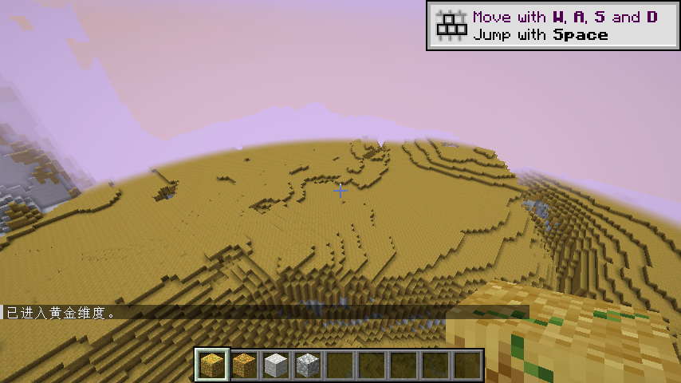
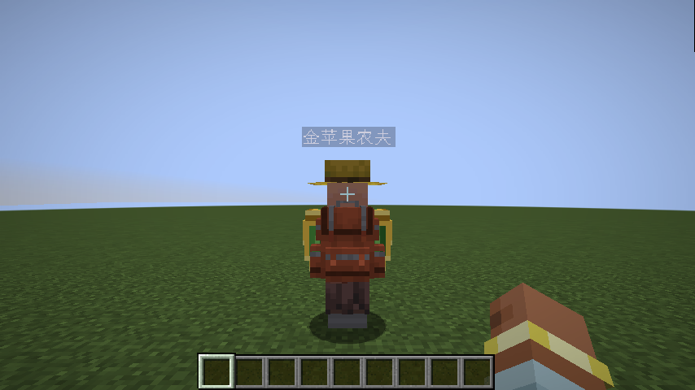
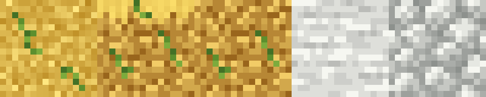

# 金苹果套装 · Golden Apple Set

围绕金苹果打造的 Minecraft Java 版 Forge 模组：从能食用的金苹果剑，到绿叶金甲、工具、村庄商人和独立黄金维度。

**当前版本：1.7.0 · Minecraft 1.20.1 · Forge 47.x · Java 17**
实际开发与客户端验证环境：Forge 47.4.23。模组 ID：`gas`。



## 玩法内容

### 金苹果装备

- **金苹果剑**：攻击速度 1.6、耐久 512。命中有 20% 概率给予生命恢复 I；长按右键可消耗 8 点耐久获得饱食、伤害吸收 II 和生命恢复 II，冷却 10 秒。
- **四件护甲**：原版金甲造型，绿色小叶片仅在边缘点缀。护甲值为头盔 3、胸甲 8、护腿 6、靴子 3，总计 20；每件韧性 2，总计 8。
- **四件套效果**：穿齐后生命上限 +6（3 颗心）并持续获得生命恢复 I。脱装后生命上限加成移除，恢复余效最多 3 秒自然消退。
- **镐、斧、锹、锄**：基础挖掘速度 12，高于原版下界合金的 9；采集等级仍为铁级，不能采集黑曜石或远古残骸。
- **弓和盾牌**：原生模型、蓄力/格挡状态，支持主副手盾牌格挡。
- 独立创造标签页收录 11 件装备、农夫刷怪蛋及 4 种地形方块。装备配方沿用原版对应工具、护甲的排列形状，以金苹果为主要材料。

### 金苹果农夫

村庄中随机出现的专属商人，沿用农夫草帽与动作，增加金绿色双肩披肩。

- 默认 **4 颗绿宝石 → 1 个普通金苹果**。
- 每轮最多交易 64 次，每 6000 tick（正常速度约 5 分钟）自动补货。
- 支持配置刷新概率、价格、补货间隔；提供专用刷怪蛋。
- **可选精妙背包联动**：同时安装 Sophisticated Backpacks 和 Sophisticated Core 后，每位农夫随机佩戴普通/铜/铁/金/钻石/下界合金背包之一，并随 NPC 保存。



### 黄金维度与方块

独立维度 `gas:golden_realm`，采用主世界噪声地形与淡紫色天空。1.7.0 的新生成区域以金苹果草地、泥土及白石地下层组成，洞口和深切地形可露出白岩。旧版本已生成的金块区块保留原样。

| 方块 | 外观 | 常规采集 |
| --- | --- | --- |
| 金苹果草方块 | 金色草皮、金色土层与绿色细纹 | 掉金苹果泥土 |
| 金苹果泥土 | 去掉草皮的金色土层 | 掉自身 |
| 金苹果石头 | 白色原版石头颗粒 | 镐挖掘掉金苹果圆石 |
| 金苹果圆石 | 白色碎石与灰色接缝 | 镐挖掘掉自身 |

精准采集可获得草方块、石头本体。四种方块均使用原生 16×16 纹理。



拥有管理员权限或启用作弊时可使用：

```mcfunction
/gas gold
/gas overworld
/give @s gas:golden_apple_farmer_spawn_egg
```

## 安装与构建

安装 Minecraft 1.20.1 和兼容 Forge 47.x，将构建产物放入游戏或服务器的 `mods` 文件夹，同一实例只保留一个 `gas` 版本。精妙背包联动需要另外安装精妙背包及精妙核心，基础模组可独立使用。

源码构建需要 **JDK 17**，仓库自带 **Gradle 8.1.1 Wrapper**。首次构建需联网下载 Gradle、Forge 和 Minecraft 依赖。

```powershell
# Windows，在仓库根目录执行
cd gas_mod
.\gradlew.bat build
```

```bash
# Linux / macOS
cd gas_mod
chmod +x gradlew
./gradlew build
```

产物：`gas_mod/build/libs/gas-1.20.1-1.7.0.jar`。

开发客户端：`./gradlew runClient`；开发服务器：`./gradlew runServer`。如默认仓库网络不可用，可使用 `-I scripts/build_with_mirror.gradle` 选择项目提供的镜像配置。

## 源码结构

| 路径 | 内容 |
| --- | --- |
| `gas_mod/src/main/java/com/gas/mod/` | 模组入口、装备行为、参数与注册 |
| `.../entity/`、`.../world/` | 农夫实体、村庄刷新与维度传送 |
| `.../equipment/`、`.../compat/` | 四件套效果与可选背包联动 |
| `.../client/` | 农夫披肩与专属客户端渲染 |
| `gas_mod/src/main/resources/` | 原生纹理、模型、语言、配方、掉落表、维度生成 |
| `gas_mod/src/renderSmoke/` | 按需启用的实际客户端回归检查，不进入发布 JAR |
| `gas_mod/scripts/` | 像素资源生成、资源校验和开发检查配置 |
| `gas_asset_build/` | 盾牌和披肩原生资源生成工具 |
| `gas_mod/art/` | 预览、像素参考与实机验证截图 |

详细说明：[合成表](gas_mod/CRAFTING.md) · [护甲套装](gas_mod/ARMOR_SET.md) · [农夫](gas_mod/FARMER.md) · [背包联动](gas_mod/BACKPACK_COMPAT.md) · [维度](gas_mod/GOLDEN_REALM.md) · [方块](gas_mod/REALM_BLOCKS.md)。

## 校验与开发

完成首次构建后，在 `gas_mod` 中执行（Python 3、Node.js）：

```bash
python scripts/verify_mod.py
python scripts/verify_rendering.py
node scripts/build_leaf_armor.cjs --check
node scripts/build_realm_blocks.cjs --check
```

实际客户端检查例子：

```bash
./gradlew -I scripts/render_smoke.gradle -PgasSmoke=blocks runClient
./gradlew -I scripts/render_smoke.gradle -PgasSmoke=armor runClient
```

已有独立 Forge 47.4.23 客户端验证记录覆盖装备渲染、护甲加成、商人交易、可选背包联动及新区块生成。完整整合包的兼容性需在对应环境中验证。

## 许可与致谢

项目原创代码按 [MIT License](LICENSE) 发布。Minecraft 原版参考纹理、名称及衍生资源的说明见 [THIRD_PARTY_NOTICES.md](THIRD_PARTY_NOTICES.md)。Sophisticated Backpacks/Core 由其作者独立提供，本仓库不包含这些模组的 JAR、源码或材质。
